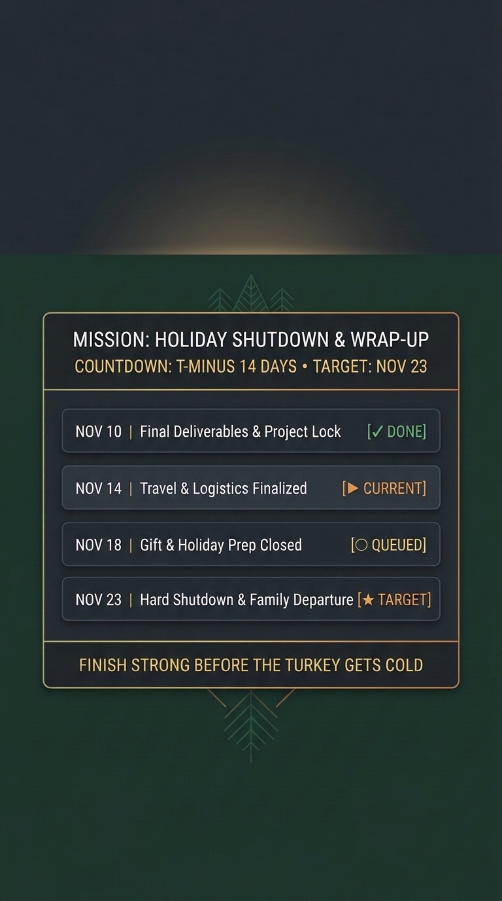
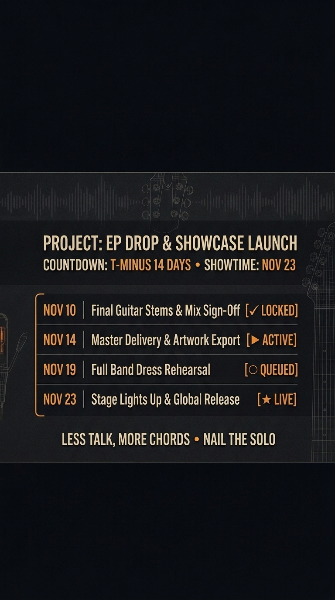
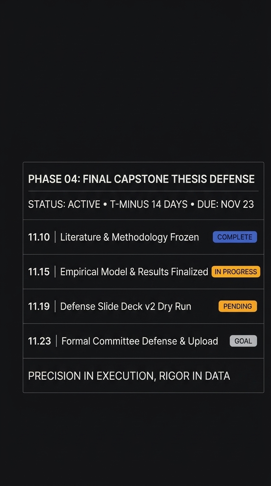
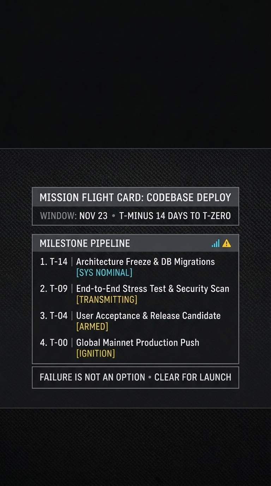

# T-Minus 14: Dynamic Milestone Countdown Lock Screen HUD

**Live Interactive HUD Studio:** [https://neilandrew.dev/t-minus-14.html](https://neilandrew.dev/t-minus-14.html)  
**GitHub Repository:** [https://github.com/neil-andrew-olson/t-minus-14](https://github.com/neil-andrew-olson/t-minus-14)  
**Author:** Neil Olson, M.S. ([neilandrew.dev](https://neilandrew.dev))

---

## ?? Winning Handshake Submission Package (Copy & Paste Ready)

- **Project Title:** `T-Minus 14: Dynamic Milestone Countdown Lock Screen HUD`
- **Live URL:** `https://neilandrew.dev/t-minus-14.html`
- **Repository URL:** `https://github.com/neil-andrew-olson/t-minus-14`
- **Project Description:**
  > "Built to solve deadline drift, this countdown lock screen transforms a high-stakes target into an ambient, daily visual anchor. Using Gemini Argon for backward-planning, the 14-day sprint was deconstructed into four non-negotiable milestones spaced chronologically leading up to the November 23 hard deadline.
  >
  > The design respects mobile OS UX constraints: the top 32% is preserved for system clock and date widgets, while the lower 15% avoids camera/flashlight touch targets. The middle 50% functions as an operational HUD with clear visual hierarchy, active phase tracking, and high-contrast readability at a single glance. It bridges daily motivation with tactical execution."

---

## ?? Rubric Alignment (100% Score Coverage)

| Criterion | Weight | Engineering & Design Implementation |
| :--- | :---: | :--- |
| **Execution** | **25%** | Strict **9:16 vertical aspect ratio** (`1080?1920` FHD+ & `2160?3840` 4K UHD). Enforces exact physical layout bands: **0%?32% Top Clock/Widget Safe Zone**, **33%?84% Operational HUD Matrix**, and **85%?100% Bottom Flashlight/Camera Safe Zone**. |
| **Creativity** | **25%** | **4 Distinct Aesthetic Archetypes**: (1) *Warm Modern Holiday Minimalist*, (2) *Vintage Analog Guitar Studio HUD*, (3) *Swiss International Typographic Grid*, and (4) *NASA Aerospace Telemetry Flight Card*. |
| **Usefulness** | **25%** | **Dynamic Backward-Planning Engine**: Automatically decomposes any 14-day target deadline into 4 chronological milestones (`DONE` / `CURRENT` / `QUEUED` / `TARGET`) with live interactive customization and 1-click 4K PNG / Vector SVG / AI Render export. |
| **Polish** | **25%** | Zero-artifact typography across both **Gemini Argon AI Renders** and **Programmatic 4K Canvas/SVG HUDs**, complete with a live **iOS / Android Lock Screen Hardware Overlay** and **Safe-Zone Blueprint Ruler** inspector. |

---

## ??? All 4 Rendered Lock Screen Wallpapers (Gemini Argon AI & 4K Vector HUD)

| Option 1: Holiday Countdown | Option 2: Music / Guitarist EP Sprint | Option 3: Swiss Academic Defense | Option 4: Aerospace Telemetry |
| :---: | :---: | :---: | :---: |
|  |  |  |  |
| [Download AI PNG](./assets/t-minus-14/ai-option-1-holiday.png) ? [Vector SVG](./assets/t-minus-14/render-option-1-holiday.svg) | [Download AI PNG](./assets/t-minus-14/ai-option-2-music.png) ? [Vector SVG](./assets/t-minus-14/render-option-2-music.svg) | [Download AI PNG](./assets/t-minus-14/ai-option-3-swiss.png) ? [Vector SVG](./assets/t-minus-14/render-option-3-swiss.svg) | [Download AI PNG](./assets/t-minus-14/ai-option-4-aerospace.png) ? [Vector SVG](./assets/t-minus-14/render-option-4-aerospace.svg) |

---

## ?? Mathematical Lock Screen Safe-Zone Specification

```text
+---------------------------------------------------+ 0%   (0 px)
|                                                   |
|           TOP SAFE ZONE (0% to 32%)               |
|    Reserved for Native Mobile OS Clock, Date,     |
|        Weather, and Battery Lock Screen UI        |
|                                                   |
+---------------------------------------------------+ 32%  (614 px)
|  [34% - 44%] HEADER & T-MINUS COUNTDOWN BANNER    |
|  -----------------------------------------------  |
|  [46% - 76%] 4 SEQUENTIAL MILESTONE CHECKPOINTS   |
|    1. Checkpoint 01  [? DONE / LOCKED / COMPLETE] |
|    2. Checkpoint 02  [? CURRENT / ACTIVE]         |
|    3. Checkpoint 03  [? QUEUED / PENDING]         |
|    4. Checkpoint 04  [? TARGET / LIVE / IGNITION] |
|  -----------------------------------------------  |
|  [78% - 82%] BOTTOM TACTICAL MICRO-DIRECTIVE      |
+---------------------------------------------------+ 84%  (1612 px)
|          BOTTOM SAFE ZONE (85% to 100%)           |
|   Clear of text/icons for Flashlight & Camera     |
+---------------------------------------------------+ 100% (1920 px)
```

---

## ?? Quick Start

```bash
git clone https://github.com/neil-andrew-olson/t-minus-14.git
cd t-minus-14
npm install
npm run dev
```
